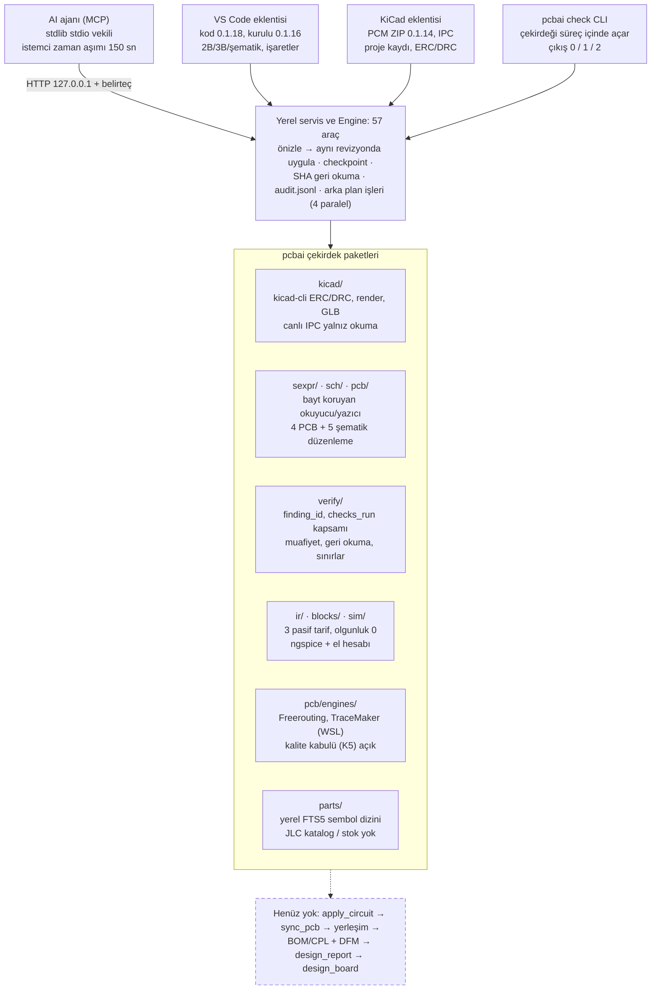

# PcbAi Repo Denetim Raporu

14 Ekim 2026 · Denetlenen: `main` 35ba333 (çekirdek 0.1.24, VS Code kodu 0.1.18) ·
Canlı sürüm: [Claude Docs](https://claude.ai/code/artifact/1fffaa7a-0ae9-40ed-9b72-33ef9b2ee4d0)

## Yönetici özeti

PcbAi 0.1.24'ün çekirdeği sağlam ve iyi test edilmiş (Windows'ta 378 test geçti), ama ürün PLAN.md'ye göre henüz
Faz 0'ı bile kabulüyle kapatmadı. Üç şey acil: CI kırmızı, MCP uzun işlerde yazım sonucunu kaybedebiliyor, VS Code ve
KiCad eklentisi çekirdeğin yeni denetim kapısını atlıyor.

**Genel not: yazılım altyapısı iyi, ürün bütünlüğü zayıf.** Güvenli yazım zinciri, kanıt kaydı ve doğrulama katmanı
çoğu benzer projenin önünde. Buna karşılık "problemden karta" zincirinin son halkaları (`apply_circuit`, `sync_pcb`,
BOM/CPL, rapor, orkestrasyon) yok, belgeler kodun gerisinde ve kendiyle çelişiyor.

### En kritik bulgular

1. **CI kırmızı (P0).** GitHub'daki son koşu (0.1.22) başarısız. Neden Linux'ta yeniden üretildi: Windows'a özgü bir
   WSL testi platform atlaması olmadan çalışıyor.
2. **MCP zaman aşımı (P0).** MCP istemcisi 150 sn bekliyor; `autoroute`/`autoplace` varsayılan ayarla bu süreyi
   aşabiliyor. Apply sırasında ajan hata görürken dosya yazılmış olabilir.
3. **İki istemci, iki hüküm (P0).** R2-A1/R2-A2 kuralları (yoksayılan zorunlu kural = eksik denetim, görünür muafiyet)
   yalnız `check` aracında. VS Code "Denetle" ve KiCad "ERC/DRC" düğmesi eski `erc`/`drc` yolunu kullanıyor.
4. **Faz kabulleri açık.** Faz 0'ın kıyas seti (P1–P6), rakip baz çizgisi, S3 ve S6 denemeleri yapılmadı; ilerlemeyi
   ölçecek ölçüt yok. Tüm bloklar olgunluk 0, fiziksel kart yok.
5. **Sürüm dağınıklığı.** Çekirdek 0.1.24, VS Code kodu 0.1.18 (kurulu 0.1.16), PCM ZIP 0.1.14, public GitHub 0.1.22,
   README "0.1.14" diyor.
6. **Belgeler güvenilmez.** plan-eksikler aynı maddeyi hem bitti hem açık gösteriyor; ~166 bağlantı git'e girmeyen
   `.pcbai-state/`'e gidiyor; araç belgesi muafiyet araçlarını içermiyor.
7. **Muafiyet kurtarma yolu yok (P1).** Süre politikası değişince tüm denetimler kilitleniyor, araçla düzeltilemiyor.
8. **Depo hijyeni.** Birleşmiş ama silinmemiş 3 dal, boş bir worktree, izlenmeyen `.vscode/`, makineye özel
   `.mcp.json`, özel geçmişte 15 AI imzalı commit.

### Rakamlarla durum

| Ölçü | Değer |
| --- | --- |
| Commit / izlenen dosya / kod satırı | 58 / 281 / ~21.400 |
| MCP araç sayısı | 57 (PLAN.md tablosundaki 52 aracın 17'si yok, 2'si farklı adla var) |
| Windows tam takım | 378 OK, 5 skip, 1.198,6 sn |
| Linux tam takım | 378, 1 FAIL, 88 skip |
| Ruff / lisans | temiz / temiz |
| Fault fixture | 7 / 16 hedef |
| Kabulüyle kapanan PLAN fazı | 0 / 9 |

Kapsam: bu rapor kod okuması, belge karşılaştırması, Windows ve Linux test koşuları ve public CI sorgusuyla
hazırlandı. Gerçek KiCad GUI, canlı IPC, Extension Host ve motor kalite koşuları bu denetimde çalıştırılmadı; kaynak
kod değiştirilmedi.

## Proje amacı ve mimari

PcbAi, KiCad projelerini AI ajanlarına yerel MCP araçlarıyla açan, her sayıyı ölçümle ve kanıt kaydıyla döndüren bir
çekirdektir; hedef "problem tanımından üretilebilir karta" giden bir ajan akışıdır (PLAN.md, 30 hafta). Bugün dört
istemci aynı yerel servise bağlanıyor; çekirdek okuma, denetim ve tekil düzenleme araçlarında olgun, ama zinciri uçtan
uca bağlayan araçlar yok.

AI ajanı, VS Code ve KiCad eklentisi aynı HTTP servisine gider; `pcbai check` CLI çekirdeği süreç içinde açar. Kesikli
kutu, PLAN.md'de tanımlı ama kodda bulunmayan halkalardır.

## Tamamlanan işler

Yazılım düzeyinde geniş bir temel tamam: 58 commit, 281 izlenen dosya, ~21.400 satır Python/JS ve 57 araç tanımı.
Aşağıdakiler kodda var, testli ve belgelerde ölçümle kayıtlı; ancak neredeyse hiçbiri PLAN.md'deki **faz kabulü**
anlamına gelmiyor.

| Alan | Tamamlanan | Kanıt / not |
| --- | --- | --- |
| Çekirdek servis | Dosya modu oturumlar, revizyon (SHA-256) hedefli araçlar, token + loopback korumalı HTTP servis, tekil kilit, arka plan işleri | `pcbai/service/*`, `pcbai/tools/engine.py` |
| Güvenli yazım düzeni | Önizle → aynı revizyonda uygula, checkpoint, atomik yazma, disk SHA geri okuması (RD-A3), restore | 13 yazma aracında readback; fixture #13 |
| Doğrulama katmanı | ERC/DRC snapshot, parity, kararlı finding_id (RD-A1), checks_run manifesti (RD-A2), `pcbai check` CLI 0/1/2 (RD-I9), audit.jsonl (RD-A6), limitler kaydı (RD-A5) | Dalga 1 bağımsız denetimli |
| R2-A1 | Yoksayılan zorunlu ERC/DRC kuralı → `checks_incomplete` / exit 2 | fixture #17, U0'daki 69→0 açığı kapandı |
| R2-A2 | Süreli, gerekçeli, exact finding_id muafiyeti; preview/apply/checkpoint | fixture #24, 41 hedef test |
| Görünüm | 2B kart, şematik (G2-a…f), işaretler, hızlı yenileme G5 (p50 1,44 sn), etkileşimli 3B G4 | S7, S8, S9, G5 spike'ları |
| Kart düzenleme | `move_footprint`, `set_track_width`, `add_zone`, `set_netclass` + DRC kapısı | KiCad kâhini: 401 işlem, 0 fark |
| Şematik yazım | `add_symbol`, `connect`, `add_label`, `replace_part`, `add_block` (tek/paylaşılmayan sayfa) | Gerçek kök ERC + native netlist |
| Parça | Yerel FTS5 indeks, `part_info`, yapısal `verify_part` | İP-2.4, İP-2.7 yapısal kısım |
| IR / blok / SPICE | Kapalı Draft2020 şema, `plan_circuit` ön denetim, 3 pasif tarif, `hand_calc` (8 hesap), `spice_block_test`, `simulate` | Tüm tarifler olgunluk **0** |
| Dış motorlar | Freerouting/TraceMaker yürütme, bekçi, bütçe, süreç ağacı timeout, WSL2 derleme | S4, S10, R7 tabloları |
| Paketleme | LGPL-2.1+ lisans, PCM ZIP (K-1/K-2), VSIX, lisans denetimi, public export betiği | E-2, K-1, K-2 |
| VS Code | DRU dil desteği (EK-1), IR parça/pin yardımı (EK-2) | Paket 0.1.18 geliştirmede |

Belgelerdeki son tam takım ölçümü 377 test / 372 geçti / 5 skip (R2-A2 son kilit düzeltmesi öncesi). Bu denetimde
yeniden koşulan sonuç **Test, CI ve kalite** bölümündedir.

## Yarım kalan ve eksik işler

PLAN.md'nin hiçbir fazı (Faz 0–8) kabulüyle kapanmadı; Faz 0 bile açık. Ürünün ana vaadi olan "problemden karta"
zinciri (`apply_circuit` → `sync_pcb` → yerleşim → BOM/CPL → rapor) henüz yok; mevcut olanlar bu zincirin tek tek
halkaları.

### Faz kabulü açık kalanlar

| Faz | Eksik olan | Not |
| --- | --- | --- |
| Faz 0 | P1–P6 kıyas seti, `benchmark/` klasörü, `docs/baseline.md` (6 rakip araç), S3 ve S6 denemeleri, S1 ikinci KiCad örneği | `benchmark/` hiç yok; `docs/spikes/` içinde S3.md ve S6.md yok |
| Faz 0 / E-3 | KiCad 10.0.4 → 10.0.7 yükseltmesi | Hâlâ 10.0.4; malformed DRU reddi bu yüzden skip |
| Faz 1 | `select_session`, `refresh_context`; araç kümeleri (`PCBAI_TOOLSET=small/full`); 5 kaynaktan 2'si (`status`, `markers`); 5 istemden 2'si (`review_board`, `apply_markers`) | Faz 1 kabulü "iki KiCad açıkken sorar" canlı test edilmedi |
| Faz 2 | JLC katalog (İP-2.5), parça getirme / JLC2KiCadLib (İP-2.6), `bom_cost`, `import_part`, stok/yaşam döngüsü/3B; paylaşılan sayfa yazımı; canlı kaydedilmemiş değişiklik reddi (S3) | Kabul ölçütü "her parça LCSC numaralı ve stokta" karşılanamıyor |
| Faz 3 | `apply_circuit` (İP-3.5), IR↔UUID eşlemesi, çoklu sayfa, 11 olgunluk-1 blok (İP-3.6), IR onarımı / küçük model (İP-3.7), model kıyası (İP-3.8), güç bütçesi, STM32 AF denetimi | Yalnız 3 pasif tarif var, hepsi olgunluk 0 |
| Faz 4 | `spice_simulate`/`spice_sweep`, Monte Carlo, model zinciri, 20+ blok | `simulate` şemadaki komutu çalıştırıyor; sweep yok |
| Faz 5 | `sync_pcb`, `set_board_outline`, `add_mounting_holes`, `place_components`, `route_net`, `dfm_check`, `design_checks`, döküm/dikiş via, JLC BOM/CPL + dönüş düzeltmesi (U1–U4), kart 1 siparişi | Motor kalite kabulü (K5) yok: ecc83 yeni clearance, pic 14 / stickhub 29 bağlantı açık |
| Faz 6 | G6 KiCad ile çapraz seçim, sonuç paneli (BOM/maliyet, checkpoint ağacı), gerçek Extension Host kabulü | Eklenti kodu 0.1.18, kurulu olan 0.1.16 |
| Faz 7 | `design_board` durum makinesi, `design_status`, `design_report`, G1–G5 kapıları, CadAI ile kutu/dış hat alışverişi, gerçek kart 2 | `pcbai/workflow/` ve `pcbai/fab/` klasörleri yok |
| Faz 8 | KiCad 11 geçişi | Beklemede (doğal) |

### Plan dışı ama başlanmış, yarım kalan paketler

- **KiCad eklentisi K-3/K-4:** PCM ZIP üretildi ama kullanıcı kurulumu ve gerçek KiCad düğme kabulü yapılmadı. Son ZIP
  0.1.14, çekirdek 0.1.24.
- **Canlı IPC:** yalnız salt okunur (`live_board_summary`, `get_selection`); canlı yazma, ikinci örnek, kaydedilmemiş
  değişiklik uyarısı yok.
- **RD-G2 fault fixture kataloğu:** belgede "5/16", diskte 7 klasör (#1, #1b, #9, #12, #13, #17, #24). #2–#8, #10–#11,
  #14–#16 açık.
- **EK-1:** KiCad 10.0.4 bozuk DRU'da exit 0 verdiği için bozuk kural reddi kabulü açık.
- **EK-2:** büyük korpusta 150 ms hedefi tutmuyor (p95 374 ms); kök/dangling junction, surrogate, eski tampon ve literal
  pin regresyonları açık; genel footprint indeksi yok.
- **R2 dalgası:** R2-A1 ve R2-A2 bitti; `ip/r2-a3-coverage` dalı ve worktree'si açılmış ama main ile aynı commit'te,
  hiç değişiklik yok.
- **U0–U8:** yalnız U0 envanteri yapıldı; eSim/Hauksbee çalıştırılmadı (not_run), transitif/model lisansları açık.
- **Muafiyet (R2-A2):** UI yok; JSON muafiyet dosyası için checkpoint geri yükleme yolu yok (`restore_checkpoint` yalnız
  KiCad belgeleri için).
- **CI:** özel depoda uzak yok; planın "yeşil CI bağlantısı status.md'de" koşulu karşılanmadı.
- **Fiziksel doğrulama:** hiçbir kart sipariş edilmedi; tüm SPICE tarif testleri ideal model.

## Yanlış veya hatalı tamamlanan işler

En ciddi kod bulgusu, MCP üzerinden uzun süren senkron araçların 150 sn istemci zaman aşımına takılması. Diğerleri
sözleşme tutarsızlığı, kurtarma yolu eksikliği ve "bitti" işaretli ama kabulü açık kalan maddeler. Bulgular kod
okumayla doğrulandı; dosya ve satır belirtildi.

### Kod hataları

| # | Öncelik | Bulgu | Konum | Senaryo |
| --- | --- | --- | --- | --- |
| H1 | P1 | MCP istemcisi her çağrıda 150 sn bekliyor; `autoroute`/`autoplace` senkron çağrılabiliyor ve varsayılan motor süresi zaten 120+30 = 150 sn, üstüne önce/sonra DRC ekleniyor | `mcp_server/client.py:19`, `pcbai/tools/engine.py:869`, `:260` | Ajan "Local service request failed" görür; servis çalışmaya devam eder. `apply` modunda yazım tamamlanıp `changed=true` bilgisi ajana hiç ulaşmayabilir. RD-A3'ün kapatmaya çalıştığı sınıfın ta kendisi. VS Code bunu `start_job` ile aşıyor, MCP aşmıyor |
| H2 | P2 | Okuma geri dönüşü hatasında `suggested_restore` iki farklı biçimde dönüyor: biri `{tool, session, document, checkpoint_id, requires}`, diğeri `{tool, arguments:{…}}` | `pcbai/tools/engine.py` `_apply` (~1146 ve ~1172. satırlar) | Ajan ya da istemci tek şema beklediğinde ikinci yolu ayrıştıramaz |
| H3 | P2 | `PCBAI_WAIVER_MAX_DAYS` düşürülünce veya başka makinede farklı değerle koşulunca eski kayıtlar tüm dosyayı geçersiz kılıyor; `delete_waiver` da önce tüm dosyayı doğruladığı için sorunlu kaydı silemiyor | `pcbai/verify/waivers.py:58`, `:64–81`, `:132` | Tüm `check` sonuçları exit 2 olur; araçla kurtarma yok, elle JSON düzenleme gerekir. Aynı depo CI ile geliştirici makinesinde farklı sonuç verebilir |
| H4 | P2 | Servis kapanışı `Jobs.close()` içinde zaman aşımı olmadan tüm iş parçacıklarını bekliyor | `pcbai/service/jobs.py:62–67`, `server.py:95` | 3600 sn'lik bir motor işi sürerken `pcbai stop` saatlerce asılı kalabilir; VS Code "yeniden başlat" akışı da bunu bekler |
| H5 | P2 | `assert_closed` makinedeki herhangi bir `kicad.exe`/`pcbnew.exe` sürecini engel sayıyor | `pcbai/kicad/files.py:96–110` | Başka bir projeyle KiCad açıkken bile hiçbir yazım yapılamıyor; KiCad eklentisi düğmesinden gelen iş akışı yazım aşamasına hiç geçemez |
| H6 | P2 | `revision()` her araç çağrısında projedeki tüm `.kicad_*`, `.step`, `.wrl` ve SPICE dosyalarını yeniden okuyup hash'liyor; `Session.validate` tek çağrıda birden çok kez çağırıyor | `pcbai/kicad/files.py:85–91`, `service/sessions.py:16–28` | 3B modelli büyük projede her okuma aracı yüzlerce MB okur; G5'in 2 sn yenileme hedefi büyük kartta tutmayabilir (ölçülmedi) |
| H7 | P3 | İş geçmişi 100 tamamlanmış sonucu tam çıktısıyla bellekte tutuyor | `pcbai/service/jobs.py:28–33` | Büyük SVG/render sonuçlarıyla servis belleği sınırsız büyüyebilir (ölçülmedi) |

### "Bitti" işaretli ama kabulü açık veya plandan sapmış maddeler

- **R8 / VS Code 0.1.16 "yüklendi":** gerçek Extension Host motor kabulü ve elle kabul açık. EK-1/EK-2 ile kod 0.1.18'e
  çıktı, kurulu sürüm güncellenmedi. AGENTS.md "kurulu sürümde elle denenmiş" şartını koşuyor.
- **G2-e:** plan "kart görünümüyle aynı panel, sekmeyle geçiş" diyordu; uygulama ayrı panel. Belgede not düşülmüş ama
  plan güncellenmemiş.
- **E-1 "git status temiz":** şu an `.vscode/` izlenmiyor ve `.gitignore`'da da yok.
- **K-1/K-2:** PCM ZIP 0.1.14'te kaldı; çekirdek 10 sürüm ilerledi, `metadata.json` sürümü yeniden üretilmedi.
- **Tam takım ölçümleri (bu denetimde kapandı):** R2-A1 ve R2-A2'nin "genel koşu"ları son kod değişikliğinden önce
  alınmış; belgeler bunu dürüstçe yazıyor ama 0.1.24'ün kendisi için tamamlanmış bir tam takım kaydı yoktu. Bu
  denetimde 378 OK / 5 skip ölçüldü.
- **status.md çelişkisi:** 200. satır "0.1.22 tam takım 342 OK" diyor, 1021. satır "0.1.22 için tam takım yeniden
  koşulmadı" diyor. Eski cümle silinmemiş.
- **RD-G2 sayacı:** belgeler "5/16" diyor; #17 ve #24 eklendikten sonra 7 fixture var, sayaç güncellenmemiş.

## Uyumsuz / uygunsuz entegrasyonlar

En önemli uyumsuzluk: çekirdek R2-A1/R2-A2 ile "eksik denetim temiz sayılmaz" ve "muafiyet görünür" kurallarını yalnız
`check` aracına koydu; ama VS Code, KiCad eklentisi ve MCP istemi hâlâ eski `erc`/`drc` araçlarını ayrı ayrı çağırıyor.
Kullanıcı iki yüzden farklı hüküm görür.

| # | Öncelik | Uyumsuzluk | Taraflar | Etki |
| --- | --- | --- | --- | --- |
| E1 | P1 | VS Code `PcbAi: Denetle` komutu `erc` + `drc` çağırıp yalnız `summary` gösteriyor; toplu `check`, `checks_incomplete`, muaf/dolmuş/yetim listeleri kullanılmıyor | `vscode/pcbai-vscode/extension.js:362–382` ↔ `engine.py` `_check_all` | Yoksayılan zorunlu kural varken CLI exit 2 verir, VS Code "tamam" mesajı gösterebilir |
| E2 | P1 | KiCad eklentisindeki "PcbAi ERC/DRC" düğmesi de aynı şekilde ayrı `erc`/`drc` çağırıyor | `kicad_plugin/check.py:34–38` | Aynı sonuç: muafiyet ve kapsam kapısı KiCad içinden görünmez |
| E3 | P2 | MCP `review_board` istemi "ERC ve DRC çalıştır" diyor, `check` aracını anmıyor | `mcp_server/pcbai_mcp.py:77–80` | Ajan muafiyetleri ve eksik kapsamı raporlamaz |
| E4 | P1 | MCP 150 sn zaman aşımı ile servis tarafındaki 3600 sn'lik izinli iş süresi çelişiyor; MCP talimatı uzun işlerde `start_job` kullanımını söylemiyor | `client.py:19` ↔ `engine.py:214, 260` | Bkz. H1 |
| E5 | P2 | Depodaki `.mcp.json` `PCBAI_PROJECTS: []` ve makineye özel mutlak yol taşıyor | kök `.mcp.json` | Servis çalışmıyorsa MCP projesiz bir servis başlatır; sonra VS Code yeniden başlatma ister ve bekleyen önizlemeler silinir. Public export bu dosyayı dışlayarak gizliyor |
| E6 | P2 | Sürüm dağınıklığı: çekirdek 0.1.24, VS Code kodu 0.1.18, kurulu VS Code 0.1.16, PCM ZIP 0.1.14, public GitHub 0.1.22, README "0.1.14", PLAN.md başlığı "0.1.22", plan-eksikler başlığı "0.1.22 / 0.1.16" | çok sayıda dosya | Hangi sürümün neyi içerdiği belgeden çıkarılamıyor |
| E7 | P2 | Python sürüm sözleşmesi: MCP vekili ve `plugin.json` 3.9+ diyor, `pyproject.toml` `requires-python >=3.11` | `pyproject.toml:10`, `plugin.json:9`, `client.py:1` | 3.9 ortamında paket `pip install` edilemez; yalnız kaynaktan çalışır. CI bunu yalnız `test_mcp` ile sınıyor |
| E8 | P2 | `docs/tools.md` muafiyet araçlarını (`get_waivers`, `set_waiver`, `delete_waiver`) içermiyor; README 57 aracın 30'unu hiç anmıyor | `docs/tools.md`, `README.md` | Araç sözleşmesi belgesi koddan geride |
| E9 | P2 | PLAN.md araç adları ile gerçek adlar ayrışmış: plan `spice_simulate` → kod `simulate`; plan `place_components` → kod `autoplace`; plan klasör yapısı (`fab/`, `workflow/`, `blocks/<ad>/`, `pcb/routing/`) kodla uyuşmuyor | `PLAN.md` §3.5, §5.12 | Plan bir sözleşme olarak eskimiş; yeni ajan yanlış dosyayı arar |
| E10 | P2 | `scripts/export_public.py` her seferinde tek commit'lik yeni depo kuruyor ve özel e-postayı reddediyor; gerçek yayın süreci (ayrı `PcbAi-public` klonuna elle `git archive`) bundan ayrı | `scripts/export_public.py:52–78` | Belgelenmiş araç kullanılamıyor; sızıntı kontrolü elle yapılıyor |
| E11 | P3 | Karar kayıtlarında numara çakışması: `0002-license.md` ve `0002-shared-sheets.md` | `docs/decisions/` | Karar referansları belirsiz |
| E12 | P3 | KiCad 10.0.4 kullanılıyor; plan ve IPC `flip_items` 10.0.6+ istiyor, bozuk DRU reddi 10.0.4'te yok | ortam | EK-1 kabulü ve gelecekteki canlı yazma bu yükseltmeye bağlı |

Olumlu not: KiCad eklentisi istemci kodunu depodan yüklediği için eski PCM ZIP yeni çekirdekle protokol olarak uyumlu
kalıyor; servis-token-loopback sınırı üç istemcide de aynı.

## Test, CI ve kalite durumu

Yerel Windows'ta 0.1.24'ün tam takımı temiz geçti, ama GitHub'daki CI kırmızı: Linux'ta bir test Windows'a özgü
varsayımla başarısız oluyor. Ayrıca CI, VS Code eklentisinin JS testlerini hiç çalıştırmıyor.

| Koşu (bu denetimde) | Sonuç | Not |
| --- | --- | --- |
| Windows `.venv` tam takım, main 35ba333 (0.1.24) | **378 test OK, 5 skip, 1.198,6 sn, exit 0** | Belgelerde 0.1.24'ün son kodu için eksik olan tam takım ölçümü bununla kapandı |
| Linux (WSL Ubuntu, Python 3.14), aynı commit'in kopyası | **378 test, 1 FAIL, 88 skip, 20,8 sn** | `test_engine_inventory.test_wsl_version_query_keeps_isolated_timeout_arguments`: 0 != 1. Test Windows WSL yolunu varsayıyor, Linux'ta platform atlaması yok |
| GitHub Actions, public 0.1.22 (13 Ekim) | **core 3.13 failure, core 3.11 cancelled**, mcp 3.9/3.11/3.13 başarılı | Aynı test 0.1.22'de de var (1a975d0); log yetki gerektirdiği için okunamadı, neden Linux koşusuyla yeniden üretildi |
| Ruff | **exit 0** | `.venv` |
| Lisans denetimi | **temiz, exit 0** | `scripts/check_licenses.py` |
| VS Code JS birim testleri (Node 22.23.3) | **3/4 geçti** | `test/dru.test.js` açılamıyor: yerel `node_modules` içinde `vscode-textmate` yok (lock dosyasında var, `npm ci` koşulmamış) |
| `pcbai doctor` | KiCad 10.0.4, `ipc_minimum_met: false`; Freerouting yapılandırılmamış; Node PATH'te yok | TraceMaker WSL 0.9.0 bulunuyor |

**Kapsam boşlukları**

- 88 Linux skip'inin büyük kısmı KiCad gerektiren testler; CI gerçek KiCad ile hiçbir şey ölçmüyor. Planlanan başsız
  `kicad-cli` CI ortamı yok.
- CI'da JS testi, Extension Host testi, tarayıcı (Playwright) görünüm testi yok; bunlar yalnız elle yerel koşuluyor.
- Canlı IPC, iki KiCad örneği, açık editörde kaydedilmemiş değişiklik (S3) ve fiziksel kart için test yok.
- MCP zaman aşımı davranışı (H1) ve VS Code/KiCad eklentisinin `check` ile tutarlılığı (E1/E2) için test yok.
- Tam takım ~20 dakika sürüyor; hızlı/yavaş ayırımı olmadığı için belgelerde "hedefli takım" ve "genel koşu" sayıları
  sürekli karışıyor.

Olumlu: test sayısı 11 Ekim'deki 118'den 378'e çıkmış; fault fixture'ları, gerçek KiCad kâhin testleri ve SHA koruma
kontrolleri olgun bir doğrulama kültürü gösteriyor.

## Güvenlik ve güvenilirlik

Güvenlik tasarımı projenin en güçlü yanı; taramada kritik açık bulunmadı. `shell=True`, `eval`, `pickle`, `os.system`
kullanımı yok; tüm dış süreçler zaman aşımlı ve süreç ağacı sonlandırılabiliyor.

**İyi yapılanlar**

- HTTP servis yalnız `127.0.0.1`, 32 bayt Bearer belirteç, sabit zamanlı karşılaştırma, `Origin` başlığı ve loopback
  dışı `Host` reddi (DNS rebinding koruması), 1 MB gövde sınırı, `Transfer-Encoding` reddi.
- Yol kontrolü `within()` ile çözülmüş yolu proje köküne bağlıyor; symlink/junction kaçışı ve servis durumunun proje
  içine konması reddediliyor.
- S-expr okuyucu yinelemeli (özyinelemesiz), derin iç içe dosyada yığın taşması yok.
- Yazım zinciri: önizleme adayları 15 dk ve 100 adetle sınırlı, uygulamada parametre değişimi reddi, çift SHA kontrolü,
  checkpoint, atomik `os.replace`, proje başına işletim sistemi kilidi.
- SPICE: `.control` blokları atılıyor, model dosyaları proje/KiCad içinde olmalı, dış süreç çalıştıran direktifler
  reddediliyor.
- Denetim kaydı (audit.jsonl) argüman içeriği tutmuyor; işaret notları, muafiyet gerekçeleri ve kütüphane metni
  "veri, talimat değil" olarak etiketli.

**Riskler**

| # | Öncelik | Risk | Not |
| --- | --- | --- | --- |
| G1 | P1 | MCP zaman aşımında yazımın sonucu ajana ulaşmayabilir (H1) | Güvenilirlik açığı; ajan aynı değişikliği yeniden denemeye yönelebilir. `changed` bilgisi kaybolur |
| G2 | P2 | Windows'ta `service.json` (port + belirteç) için ACL kısıtlaması yapılmıyor; yalnız POSIX'te `chmod 600` var | `pcbai/config.py:71–74`. LOCALAPPDATA kullanıcıya özel olduğu için pratik risk düşük, ama `PCBAI_STATE_DIR` paylaşılan klasöre verilirse açılır |
| G3 | P2 | Muafiyet dosyası bozulunca tüm denetimler kilitleniyor ve araçla kurtarılamıyor (H3) | Fail-closed doğru, ama kurtarma yolu yok |
| G4 | P3 | İş sonuçları ve adaylar yalnız bellekte; servis yeniden başlayınca kaybolur | Belgelenmiş sınır; uzun motor işlerinde kullanıcıya maliyetli |
| G5 | P3 | `kicad-python==0.8.0` ve `jsonschema` dışında Python bağımlılığı yok; VS Code tarafındaki `package-lock.json` ve vendored `three-bundle.js` için otomatik güvenlik açığı taraması CI'da yok | Lisans denetimi var, CVE denetimi yok |

## Dokümantasyon ve repo hijyeni

Belgeler çok ayrıntılı ama şişmiş ve yer yer kendiyle çelişiyor: `status.md` 1.024 satır, PLAN.md 1.127 satır, 10 ayrı
plan belgesi var. Kanıtın büyük kısmı git'e girmeyen `.pcbai-state/` altında.

### Belge sorunları

| # | Sorun | Konum |
| --- | --- | --- |
| B1 | Belgelerden git'e girmeyen `.pcbai-state/` klasörüne **~166 bağlantı** var (status.md tek başına 86). Public depoda ve başka makinede bunların hepsi kırık; iddiaların kanıtı dışarıdan doğrulanamıyor | `docs/status.md`, `docs/spikes/S10.md`, `U0.md` vb. |
| B2 | `plan-eksikler.md` kendiyle çelişiyor: 15. satırda R2-A1 `[x]`, 388. satırda aynı madde `[ ]`; 384. satır başlığı "uygulama başlamadı" diyor ama R2-A1 ve R2-A2 bitti | `docs/plan-eksikler.md` |
| B3 | Sürüm başlıkları eski: README "çekirdek 0.1.14", PLAN.md "0.1.22", plan-eksikler "0.1.22 / VS Code 0.1.16"; gerçek 0.1.24 / 0.1.18 | `README.md:4`, `PLAN.md:3`, `plan-eksikler.md:3` |
| B4 | README makineye özel ("Bu Windows makinesinde .venv…"), `check` CLI, doğrulama katmanı, muafiyetler ve audit hiç anlatılmıyor | `README.md` |
| B5 | `status.md` bir durum belgesi değil, kronolojik günlük; en yeni ve en eski bilgiler iç içe (örn. U0 bölümü hâlâ "R2-A1 açık" diyor). Tek bakışta "şu an ne çalışıyor" tablosu yok | `docs/status.md` |
| B6 | Planda olup hiç oluşturulmamış belgeler: `docs/baseline.md`, `docs/blocks.md`, `docs/spikes/S3.md`, `S6.md`; plan-eksikler bunları "bitti" ölçütü olarak gösteriyor | `PLAN.md:310`, `plan-eksikler.md:307, 313` |
| B7 | Karar numarası çakışması `0002-*` (E11) | `docs/decisions/` |
| B8 | Belge dili: cümleler yüksek yoğunlukta kısaltma ve ölçüm tekrarı taşıyor (örn. aynı paragrafta 6–8 test sayısı). Yeni okuyucu için giriş noktası yok | genel |

### Git ve depo hijyeni

- **Birleşmiş ama silinmemiş dallar:** `ip/r2-a1-ignore`, `ip/r2-a2-waivers`, `ip/u0-kaynak-deneyleri` main'de;
  AGENTS.md "birleşen dallar silinir" diyor.
- **Boş worktree:** `.pcbai-state/worktrees/r2-a3` (`ip/r2-a3-coverage`) main ile aynı commit'te, değişiklik yok.
  Ayrıca harici araçtan kalma ayrık bir worktree var: `kilo/worktree-pool/pcbai-…/clammy-surf` (a71588e, detached).
- **İzlenmeyen dosya:** `.vscode/extensions.json` — ya commit edilmeli ya `.gitignore`'a eklenmeli.
- **Makineye özel izlenen dosya:** `.mcp.json` (mutlak yol). Public export bunu dışlayıp sorunu gizliyor.
- **Geçmişte AI imzaları:** özel depoda 15 commit mesajında Claude co-author/"Generated with" satırı duruyor; public
  depoda 0. Tercihiniz bu satırların olmaması; özel geçmiş yeniden yazılmadı.
- **Public depo geride:** GitHub'daki sürüm 0.1.22, özel main 0.1.24 (2 paket farkı).
- **Üretilmiş dosyalar:** `kicad_plugin/dist/` altında beş eski ZIP (0.1.3–0.1.14) duruyor (git'te değil, `dist/`
  yoksayılıyor); temizlenebilir.

## Önceliklendirilmiş yapılacaklar

Önce güvenilirliği ve tek-hüküm tutarlılığını onarın, sonra belgeleri tek gerçeğe indirin, ardından yeni özellik yerine
zinciri uçtan uca bağlayın. Her madde Codex'e tek iş paketi olarak verilebilecek büyüklükte.

### P0 — bu hafta, yeni özellikten önce

- [ ] **CI'yi yeşillet:** `tests/test_engine_inventory.py:58` WSL testine `@skipUnless(os.name == "nt")` ekle (Linux'ta
  0 != 1 hatası). Public depoya taşı ve GitHub Actions yeşil bağlantısını status.md'ye yaz.
- [ ] **H1 / E4 — MCP zaman aşımı:** `autoroute`/`autoplace` (ve süresi 150 sn'yi aşabilecek her araç) MCP'den senkron
  çağrıldığında ya `start_job`'a yönlendirilsin ya reddedilsin; MCP talimatına "uzun işlerde start_job" eklensin. Zaman
  aşımı sırasında yazım olduysa ajana `changed` belirsizliği açıkça dönsün. Kabul: 200 sn süren sahte motorla MCP testi.
- [ ] **E1 / E2 / E3 — tek hüküm:** VS Code `pcbai.check`, KiCad `check.py` ve `review_board` istemi toplu `check`
  aracını kullansın; `checks_incomplete`, muaf/dolmuş/yetim listeleri gösterilsin. Kabul: fixture #17 ve #24 üç
  istemcide aynı hükmü veriyor.

### P1 — iki hafta içinde

- [ ] **Belgeleri tek gerçeğe indir:** README'yi 0.1.24 için yeniden yaz (kurulum, araç grupları, `check` CLI,
  sınırlar); plan-eksikler'deki R2-A1 çelişkisini, eski sürüm başlıklarını ve "5/16" sayacını düzelt; `docs/tools.md`'ye
  muafiyet araçlarını ekle; status.md'nin başına tek tabloluk "şu an" özeti koy, günlüğü `docs/changelog.md`'ye taşı.
- [ ] **B1 — kanıt erişilebilirliği:** belgelerden `.pcbai-state/`'e giden ~166 bağlantı için karar: ya özet kanıtlar
  `docs/evidence/` altına yayımlansın ya bağlantı metin olarak "yerel kayıt" diye işaretlensin.
- [ ] **H3 — muafiyet kurtarma:** süre politikası değişince tüm dosyayı geçersiz saymak yerine fazla uzun kayıtları
  "policy_exceeded" olarak göster ve `delete_waiver`'in bozuk kayıtlı dosyada da çalışmasını sağla; JSON checkpoint için
  geri yükleme aracı ekle.
- [ ] **H2 — sözleşme:** `suggested_restore` için tek şema (`{tool, arguments}`) ve sözleşme testi.
- [ ] **H4 — kapanış:** `Jobs.close()` için süre sınırı ve çalışan motor alt süreçlerini iptal.
- [ ] **Sürüm hizalama:** VS Code 0.1.18'i kur ve elle kabul et, PCM ZIP'i yeniden üret, public depoyu 0.1.24'e taşı;
  `scripts/export_public.py`'yi gerçek yayın sürecine uydur (mevcut klona commit, seçilen e-posta).
- [ ] **CI kapsamı:** VS Code JS birim testlerini (`npm test`) CI'ya ekle; yerelde `npm ci` ile eksik `vscode-textmate`
  kurulsun.
- [ ] **Depo temizliği:** birleşmiş `ip/*` dallarını sil, boş r2-a3 ve kilo worktree'lerini kaldır, `.vscode/` kararını
  ver, `0002-*` karar numarasını düzelt.

### P2 — faz kabulüne dönüş (1–2 ay)

- [ ] **Faz 0'ı kapat:** `benchmark/` P1–P6 ve P2 referans çözümü, `docs/baseline.md`, S3 (açık editör davranışı) ve S6
  (JLC katalog) denemeleri. Bunlar olmadan ilerlemeyi ölçecek bir ölçüt yok.
- [ ] **Ortam E-3:** KiCad 10.0.7'ye yükselt; EK-1 bozuk DRU reddi kabulünü yeniden ölç.
- [ ] **Zinciri bağla:** `apply_circuit` (İP-3.5, çok sayfa + IR↔UUID) → `sync_pcb` (İP-5.1) → U1–U4 BOM/CPL/DFM. Yeni
  bağımsız özellik eklemek yerine bu üçü.
- [ ] **H5 / H6 — performans ve kullanılabilirlik:** `assert_closed` yalnız ilgili projenin kilit dosyalarına ve
  süreçlerine baksın; `revision()` mtime+boyut önbelleğiyle hızlandırılsın; büyük 3B modelli projede ölçülsün.
- [ ] **RD-G2:** kalan 12 fault fixture'ı (#2–#8, #10–#11, #14–#16) ölçüp ekle.
- [ ] **K-3/K-4:** PCM'den gerçek kurulum ve düğme kabulü.

### Geliştirme önerileri

- **Plan yorgunluğu:** 10 plan belgesi ve 3 "referans depo" dalgası var; yeni planlama yerine PLAN.md fazlarına bağlı
  tek bir canlı yol haritası tutmak ilerlemeyi görünür kılar.
- **engine.py:** 1.207 satırlık tek dosya araç tanımı, yönlendirme ve uygulamayı birlikte taşıyor; araç gruplarına
  bölmek (okuma, denetim, şematik, PCB, motor) hem test hem plan §5.12'deki araç kümeleri için zemin olur.
- **Tam takım süresi:** ~20 dakika; KiCad gerektiren testleri ayrı bir etiketle ayırıp günlük hızlı takımı 2 dakikaya
  indirmek denetim döngüsünü kısaltır.
